# Get started

Follow these steps to create a Singular app:

1. [Download the app boilerplate](get-started.md#download-the-app-boilerplate)
2. [Create an app in your Singular account](get-started.md#creating-an-app-template-in-your-account)
3. [Deploy your app code](get-started.md#deploying-an-app-2)
4. [Test and debug your app](get-started.md#testing-and-debugging-an-app)
5. [Publish your app](get-started.md#publishing-an-app)

## 1. Download the app boilerplate <a href="#download-the-app-boilerplate" id="download-the-app-boilerplate"></a>

Open a console and enter these commands:

```
C:\Users\tm\Singular Apps>singular createapp mySingularApp
Singular App – mySingularApp has been created
C:\Users\tm\Singular Apps>dir /S /B
C:\Users\tm\Singular Apps\mySingularApp
C:\Users\tm\Singular Apps\mySingularApp\deploykey.json
C:\Users\tm\Singular Apps\mySingularApp\source
C:\Users\tm\Singular Apps\mySingularApp\source\app.html
C:\Users\tm\Singular Apps\mySingularApp\source\icon.png
```

This set of commands creates a folder called **mySingularApp** on your local disk and clones widget boilerplate into it. We recommend adding this folder to your source code management tool.

**Description of default files**

| File              | Description                          |
| ----------------- | ------------------------------------ |
| `deploykey.json`  | A file containing the app deploy key |
| `source\app.html` | The app's source code                |
| `source\icon.png` | The app icon in .png format          |

<details>

<summary>app.html example for deployed use</summary>


```html
<!DOCTYPE html>
<html>
  <body>
    <script>
      var singularApp = null;

      // the Singular app SDK calls singularAppInit when opening the app
      // and returns the Singular app object as a parameter
      function singularAppInit(app) {
        // call your init function
        initSingularApp(app);
      }

      // your init app function
      function initSingularApp(app) {
        console.log("initSingularApp - app =", app);
        // check if the app has been created
        if (app) {
          // and if the app has been created successfully,
          singularApp = app;
          // get the composition object, output object, storage object, ...
          // ...
          console.log("singularAppInit: app created successfully - app =", app);
        } else {
          // if the app creation was unsuccessful,
          // handle error here
          // ...
          console.error("singularAppInit: Error - err =", err);
        }
      }
    </script>
  </body>
</html>
```



</details>

<details>

<summary>app.html example for local testing and development</summary>

```html
<!DOCTYPE html>
<html>
  <head>
    <!-- Load to use the Singular app SDK library -->
    <script src="https://app.singular.live/libs/singularapp/1.0.0/singularapp.js"></script>
    <!-- Load the Firebase JavaScript library -->
    <script src="https://www.gstatic.com/firebasejs/4.9.0/firebase.js"></script>
  </head>

  <body>
    <script>
      var singularApp = null;

      // Create a Singular app with the virtual app key
      SingularApp.createWithAppInstanceKey(
        "your-virtual-app-key",
        "https://app.singular.live/",
        singularAppInit, // callback function
        "your-singular-user",
        "your-singular-password"
      );

      function singularAppInit(app) {
        console.log("initSingularApp - app =", app);
        // check if the app had been created
        if (app) {
          // if the app has been created successfully,
          singularApp = app;
          // get the composition object, output object, storage object, ...
          // ...
          console.log("singularAppInit: app created successfully - app =", app);
        } else {
          // if the app creation was unsuccessful,
          // handle error here
          // ...
          console.error("singularAppInit: Error - err =", err);
        }
      }
    </script>
  </body>
</html>
```


</details>

## 2. Create an app template in your Singular account <a href="#creating-an-app-template-in-your-account" id="creating-an-app-template-in-your-account"></a>

### **Enable developer permissions**

To create a Singular.live app, you need an account that has developer permissions. Check your permissions on the **Singular Dashboard** by navigating to **User Menu** > **Settings** and checking **User Settings**.

<figure>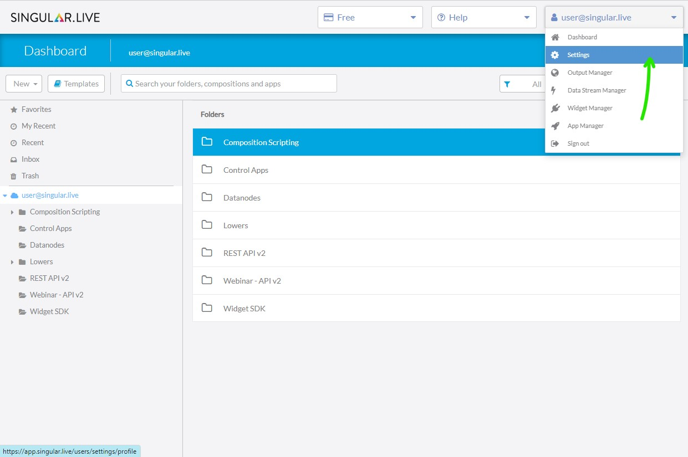<figcaption><p>User Menu -> Settings</p></figcaption></figure>

**User Administration** and **Developer Tools** should be switched on.

<figure>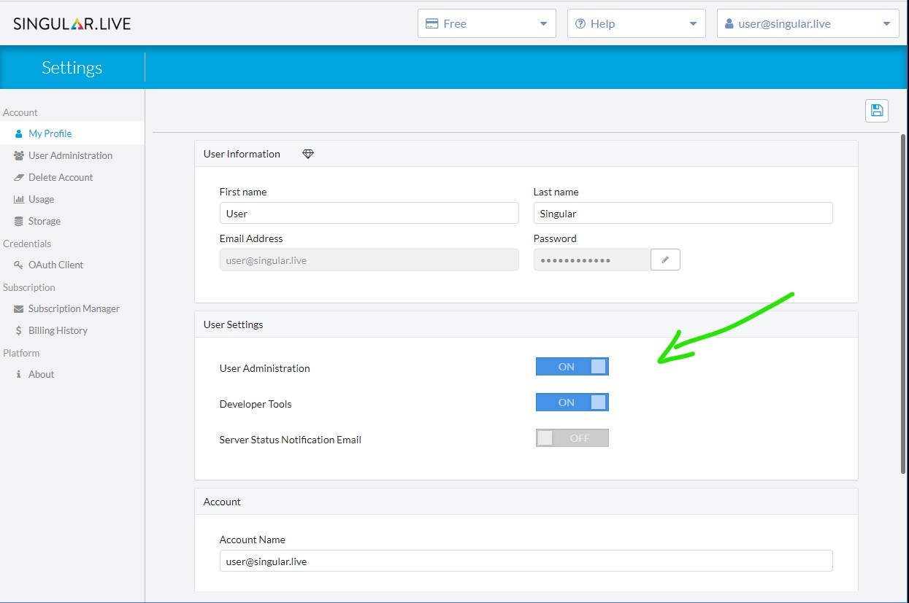<figcaption><p>User Setting and Permissions</p></figcaption></figure>

### **Create a new app**

#### 1. Navigate to **User Menu** > **App Manager**

<figure>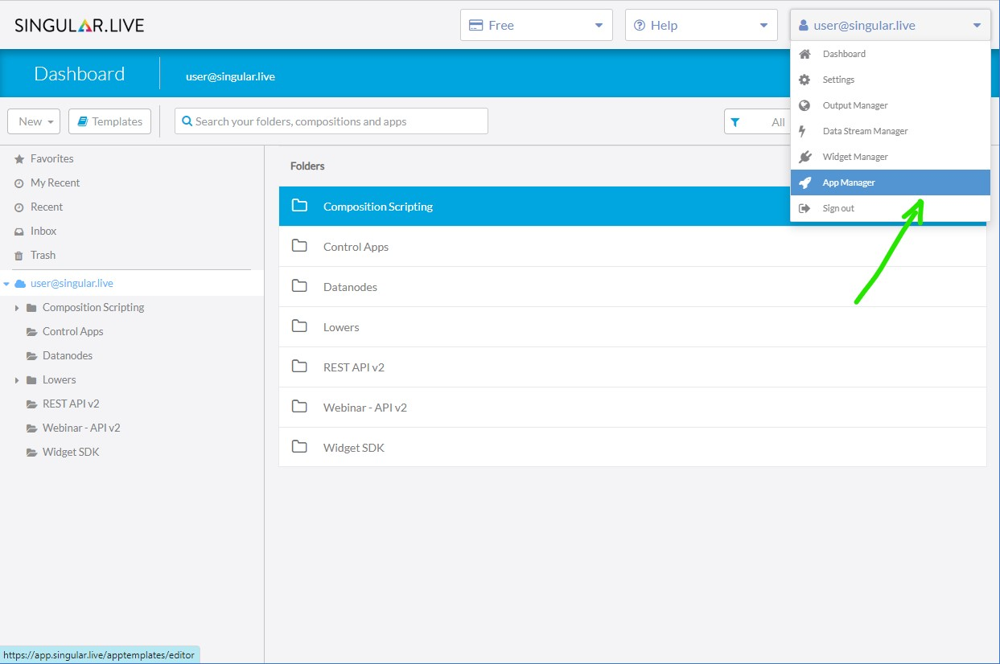<figcaption><p>User Menu -> App Manager</p></figcaption></figure>

#### **2. S**elect **New App**.

<figure>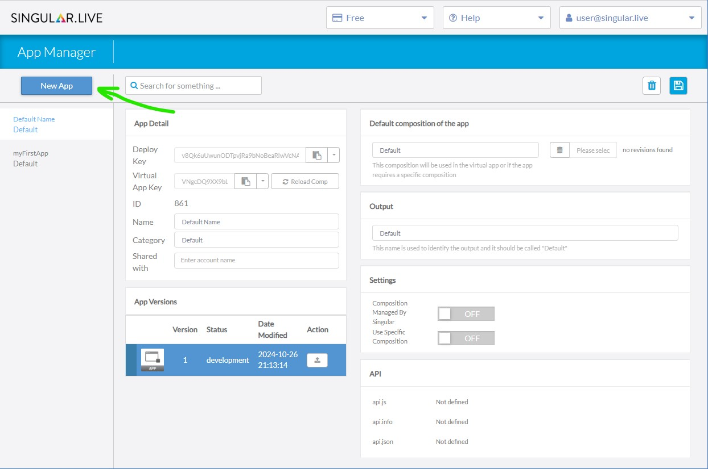<figcaption><p>App Manager -> New App</p></figcaption></figure>

### Enter a name and category for your app.


The app name doesn't need to match the name of the folder used in the `singular createapp` command in [step one](get-started.md#download-the-app-boilerplate). Nevertheless, we recommend using the same name.


<figure>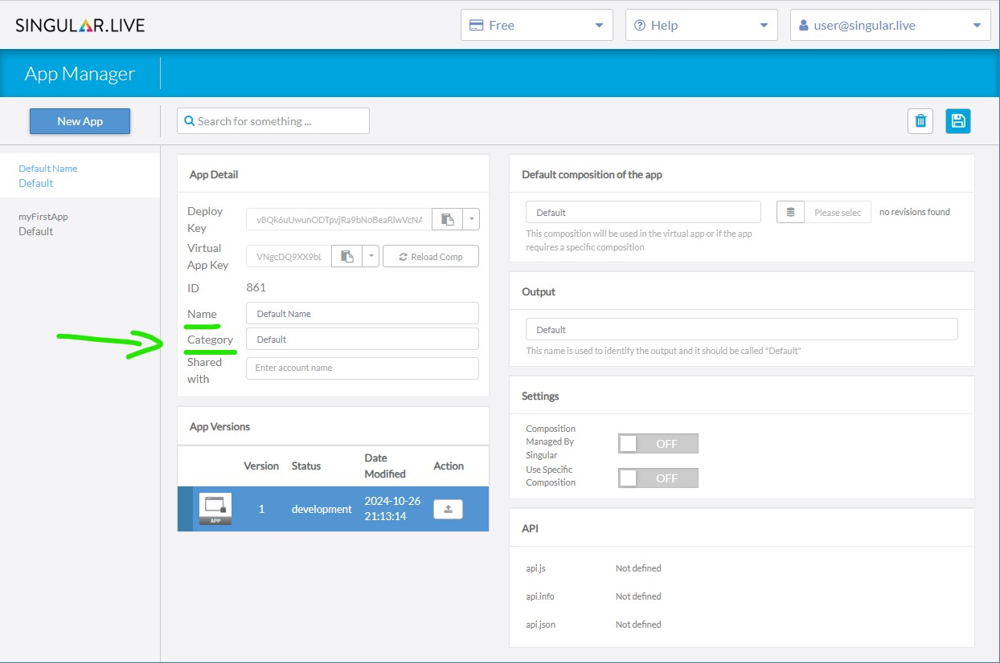<figcaption><p>App Manager - App Details</p></figcaption></figure>

### Add a default composition to your app

Select a default composition from the dashboard. This composition can be specific for the app you develop. It also will be used in the virtual app for local development and debugging.

<figure>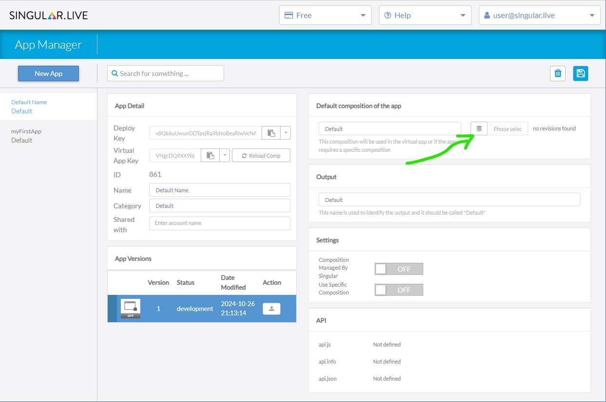<figcaption><p>App Manager - Add composition</p></figcaption></figure>

Select a specific revision or choose "Current" to select the latest one.

<figure>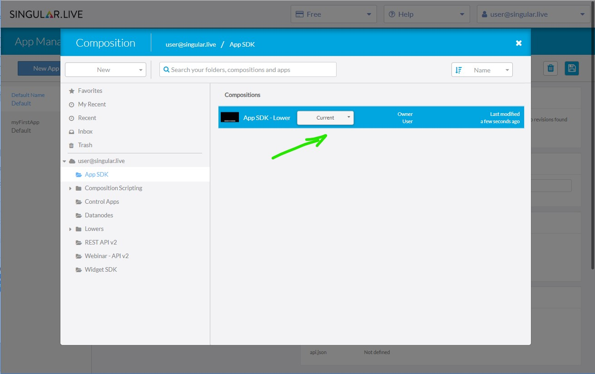<figcaption><p>App Manager - Select composition</p></figcaption></figure>

### Define the Output name

The output name is used to reference the output in App SDK functions.&#x20;


It's recommended to name the output "Default"!


<figure>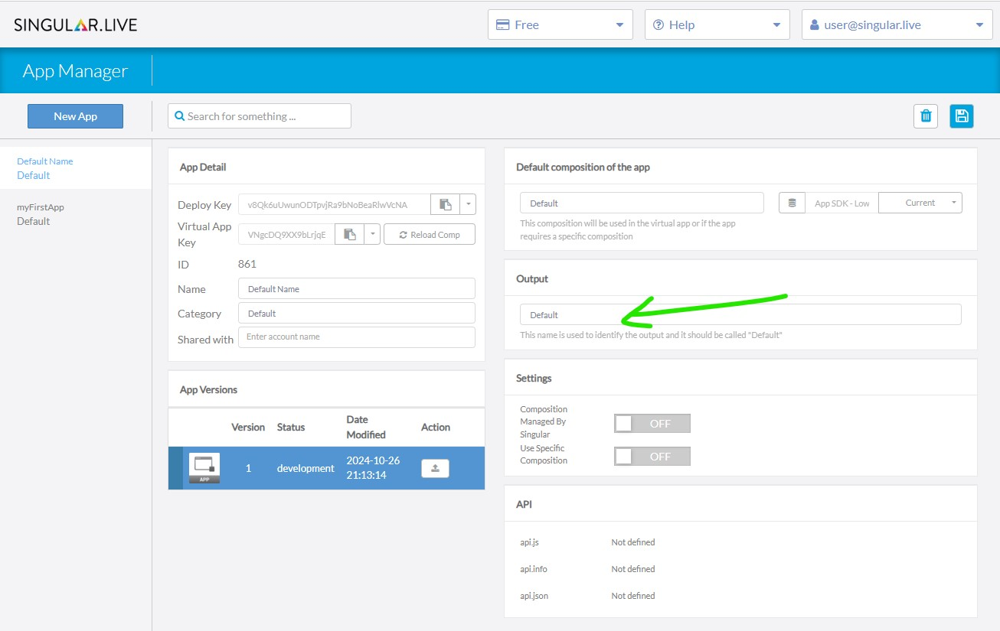<figcaption><p>App Manager - Define output name</p></figcaption></figure>

### App Settings <a href="#deploying-an-app" id="deploying-an-app"></a>

Activate your preferred options.

**Composition managed by Singular:** Enable this option to receive automatic notifications in the app when the composition changes.

**Use specific composition:** Enable this option if you're developing an app for a specific composition.

<figure>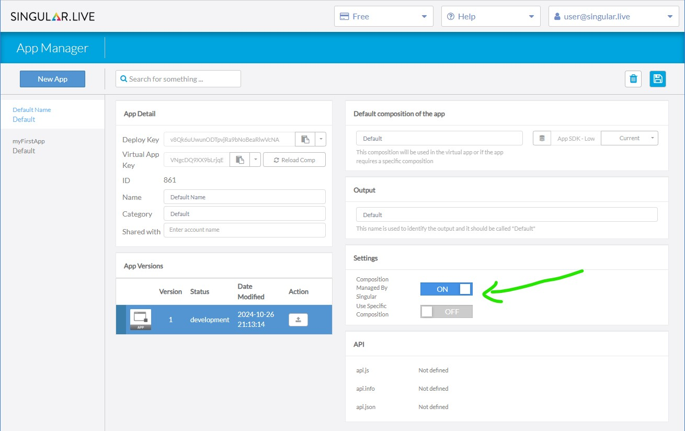<figcaption><p>App Manager - Settings</p></figcaption></figure>

### App API <a href="#deploying-an-app" id="deploying-an-app"></a>

This section provides information about the API specifications defined for your app.

<figure>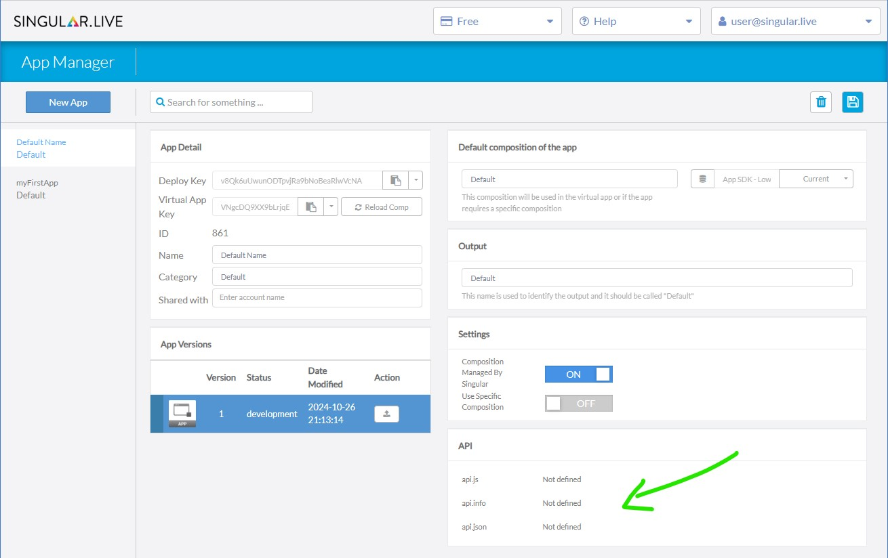<figcaption><p>App Manager - API specifications</p></figcaption></figure>

## 3. Deploy your app code <a href="#deploying-an-app" id="deploying-an-app"></a>

### Prepare deploy.json

Copy the **Deploy Key** from App Details and paste it into the `deploykey.json` file from [step one](get-started.md#download-the-app-boilerplate).

<figure>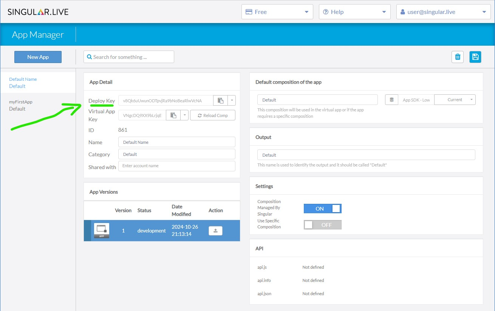<figcaption><p>App Manager - Deploy Key</p></figcaption></figure>

The file should look like this:

```json
{
  "deploykey": "v8Qk6uUwunODTpvjRa9bNoBeaRlwVcNA"
}
```

### Upload the app code

```
C:\Users\tm\Singular Apps>singular deployapp myFirstApp
-----------------------------------------------
Singular.live app deploy
Validating files in directory "source"
Creating zip file
Deploying app to Singular.live
App ID: 54 successfully deployed

C:\Users\tm\Singular Apps>
```

The deploy script will then read the deploy.json file, extract the deploy key, create a zip file of the app sources, and upload it to the Singular.live Cloud. Your app then will be visible in the **App Browser** when you create a new app instance.


Activate the `Show Dev Versions` checkbox in the **App Browser** to access the development version of your app.


The status of the development version of your app is updated each time you deploy new sources for your app. Refresh the **App Manager** and select your app to see to see its updated status.

## 4. Test and debug your app <a href="#testing-and-debugging-an-app" id="testing-and-debugging-an-app"></a>

To test your app, follow these steps:

1. Open your user folder in the Dashboard. Navigate to the apps in your assets. Choose and open the app you want to debug.
2. Use Chrome's developer tools to debug and optimize your app.

## 5. Publish your app <a href="#publishing-an-app" id="publishing-an-app"></a>

When you're done testing your app, use the `Publish` function to make it available for other users.

The `Publish` function creates an identical copy of the development version of your app and tags it as published. When you do this, the development version increases by one.

Apps never get deleted from the Singular.live platform. They are always in one of the following states:

* **development**: New apps default to the `development` status. Apps under development can only be accessed by users with developmer permission. Once your app has been fully developed and tested, you can `publish` it to make it available to other users. Apps in `development` can become `published`.
* **published**: `published` apps are available to all members of an account. Only one `published` version of an app can exist at the same time. By default, the latest published version will be used when creating an instance of an app. Apps in `published` status can be `un-published`.
* **archived**: Apps are automatically archived when a new version is published. Existing app instances that use an older version of an app will remain on this older version. A standard user can manually update the app in the app instance by selecting the **Update** button. Users with developer permission can also use any archived version of an app. Apps in `archived` status can be `published` and `depreciated`.
* **depreciated**: Set an app to `depreciated` status when you want or need to force an app instance to use the latest published version of the app. An app in `depreciated` status can be `archived`.

**Overview of app versioning**

| Status      | Action     | New status  |
| ----------- | ---------- | ----------- |
| development | publish    | published   |
| published   | un-publish | archived    |
| archived    | publish    | published   |
|             | depreciate | depreciated |
| depreciated | archive    | archived    |
