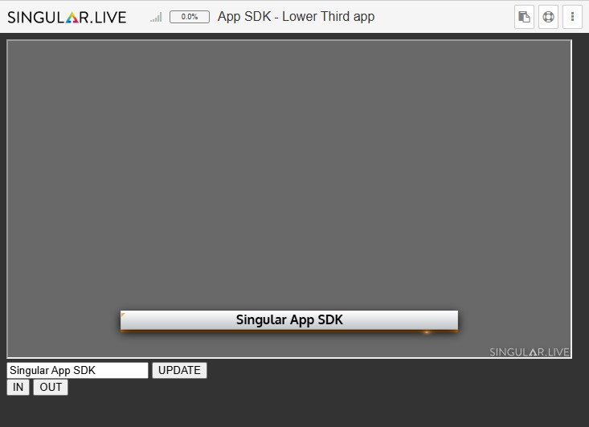

# Lower Third App

This example addresses the following App SDK methods:

* Load JavaScript libraries:
  * singularapp.js library (required for local development)
  * singulargraphics.js library (required for local preview)
  * firebase.js library (required for accessing the storage object in local development)
* Initialize the singularApp object
* Get the output object
* Get composition and subComposition objects
* Get and set payloads
* Trigger animations
* Register a storage object callback
* Update and read the storage object
* Develop and debug your app locally
* Deploy your app to your Singular account

<figure><figcaption><p>App SDK Example</p></figcaption></figure>

## Step 1: Create a New App in your Account

Follow the steps described in "[Get started](../get-started.md)" to create a new app in your Singular account.

## Step 2: Download the App boilerplate

Enter the command `singular createapp lower-third-app` in the console or a Terminal in Visual Studio Code.

```
PS E:\Singular Apps> singular createapp lower-third-app
Singular App - lower-third-app has been created
PS E:\Singular Apps>
```

This command creates the required folder structure and the downloads the app boilerplate.

<figure><figcaption><p>Boilerplate in Visual Studio Code</p></figcaption></figure>


```html
<!DOCTYPE html>
<html>

<body style="margin: 0; background:none">

  <script>
    var singularApp;

    function singularAppInit(app) {
      singularApp = app;
    }
  </script>

</body>

</html>
```


## Step 3: Load required Libraries


```html
<head>
  <!-- Load to use the Singular App SDK Library -->
  <!-- Required for local development to run and test a Singular App on a local PC -->
  <script src="https://app.singular.live/libs/singularapp/1.0.0/singularapp.js"></script>

  <!-- Load to use the Singular Graphics SDK Library -->
  <!-- Required for running a local instance of the Singular render engine -->
  <script src="https://app.singular.live/libs/singulargraphics/1.0.0/singulargraphics.js"></script>

  <!-- Load the Firebase JavaScript Library -->
  <!-- Required for local development when using the App SDK storage feature -->
  <script src="https://www.gstatic.com/firebasejs/4.9.0/firebase.js"></script>
</head>
```


## Step 4: Define the app UI


```html
<head>
  <style>
    .iFrame {
      background-color: dimgray;
      width: 700px;
      height: 394px;
    }
  </style>
</head>

<body style="margin: 0; background:none">

  <!-- iFrame to host the app output URL -->
  <div>
    <iframe class="iFrame" id="appOutput" src="./assets/Singular-Now-You-Can-700x394.jpg" scrolling="no"></iframe>
  </div>

  <div>
    <div>
      <input type="text" placeholder="Enter text here..." id="titleText" value="" onkeyup="storageDataUpdate()">
      <button onclick="sendDataToOutput()">UPDATE</button>
    </div>
    <div>
      <button onclick="playAnimation('In')">IN</button>
      <button onclick="playAnimation('Out')">OUT</button>
    </div>
  </div>

</body>
```


## Step 5: App code for local testing

<details>

<summary>app.html - merged code for local testing and debugging</summary>

```html
<!DOCTYPE html>
<html>

<head>
  <style>
    .iFrame {
      background-color: dimgray;
      width: 700px;
      height: 394px;
    }
  </style>
  <script src="https://app.singular.live/libs/singularapp/1.0.0/singularapp.js"></script>
  <script src="https://app.singular.live/libs/singulargraphics/1.0.0/singulargraphics.js"></script>
  <script src="https://www.gstatic.com/firebasejs/4.9.0/firebase.js"></script>
</head>

<body style="margin: 0; background:none">

  <!-- iFrame to host the app output URL -->
  <div>
    <iframe class="iFrame" id="appOutput" src="./assets/Singular-Now-You-Can-700x394.jpg" scrolling="no"></iframe>
  </div>

  <div>
    <div>
      <input type="text" placeholder="Enter text here..." id="titleText" value="" onkeyup="storageDataUpdate()">
      <button onclick="sendDataToSingular()">UPDATE</button>
    </div>
    <div>
      <button onclick="playAnimation('In')">IN</button>
      <button onclick="playAnimation('Out')">OUT</button>
    </div>
  </div>

  <script>
    /**
     * Global variables
     */
    var singularApp = null;
    var siOutput = null;
    var siComposition = null;
    var siStorage = null;

    /******************************************************************************
     * REQUIRED FOR DEVELOPMENT to run and test a Singular App on a local PC
     * create app instance with app instance key
     */
    if (!parent || (parent && !parent.runningOnSingularServer)) {
      SingularApp.createWithAppInstanceKey(
        "your-virutal-app-instance-key",
        "https://app.singular.live/",
        singularAppInit,
        "your-singular-user",
        "your-singular-password"
      );

      function singularAppInit(app) {
        console.log("singularAppInit() - Called");
        initSingularApp(app);
      }
    } else {
      alert("ERROR: Could not connect to Singular server.");
    }
    /**
     * END REQUIRED FOR DEVELOPMENT
     *****************************************************************************/

    /******************************************************************************
     * REQUIRED FOR DEPLOYING to run a Singular App within the Singular Platform
     * create app instance
     */
    // function singularAppInit(app) {
    //   initSingularApp(app);
    // }
    /**
     * END REQUIRED FOR DEPLOYING
     *****************************************************************************/

    var storageDataKey = "Lower Title";
    var subCompName = "Lower Title";

    /**
     * initSingularApp
     */
    function initSingularApp(app) {
      console.log("initSingularApp - app =", app);
      singularApp = app;

      // first output and composition object
      var siOutputs = singularApp.listOutputs();
      if (siOutputs && siOutputs.length) {
        siOutput = singularApp.getOutput(siOutputs[0].id);
        siComposition = siOutput.getComposition();
        var outputUrl = siOutput.getUrl();
        document.getElementById("appOutput").src = outputUrl;
      }

      // get storage object and register callback
      siStorage = singularApp.storage;
      siStorage.on(storageDataKey, storageDataChanged);
    }

    /**
     * storageDataChanged
     */
    function storageDataChanged(storageData) {
      if (!storageData) {
        return;
      }
      console.log("storageDataChanged - storageData =", storageData);
      document.getElementById("titleText").value = storageData.Title;
    }

    /**
     * storageDataUpdate
     */
    function storageDataUpdate() {
      var titleText = document.getElementById("titleText").value;
      var storageData = {
        Title: titleText
      }

      siStorage.set(storageDataKey, storageData);
      console.log("storageDataUpdate - storageData =", storageData);
    }

    /**
     * playAnimation
     */
    function playAnimation(toState) {
      console.log("playAnimation - toState =", toState);
      if (siComposition) {
        siComposition.getSubcompositionByName(subCompName).playTo(toState);
      }
    }

    /**
     * sendDataToSingular
     */
    function sendDataToSingular() {
      console.log("sendDataToSingular - called");
      var titleText = document.getElementById("titleText").value;
      var payload = {
        Title: titleText
      };

      if (siComposition) {
        siComposition.getSubcompositionByName(subCompName).setPayload(payload);
      }
    }
  </script>

</body>

</html>
```

</details>

## Step 6: App code for deploying

Enter the command `singular deployapp lower-third-app` in the console or a Terminal in Visual Studio Code to upload the app code to your account in the Singular cloud.

```
PS E:\Singular Apps> singular deployapp lower-third-app
Singular.Live app deploy
Validating files in directory ./.\lower-third-app\/source
INFO: api.info not found
INFO: api.js not found
INFO: api.json not found
Creating zip file
Deploying app to Singular.Live
App ID: 61 successfully deployed
PS E:\Singular Apps>
```

<details>

<summary>app.html - merged code for deploying to the Singular cloud</summary>

```html
<!DOCTYPE html>
<html>

<head>
  <style>
    .iFrame {
      background-color: dimgray;
      width: 700px;
      height: 394px;
    }
  </style>

  <!-- <script src="https://app.singular.live/libs/singularapp/1.0.0/singularapp.js"></script> -->
  <!-- <script src="https://app.singular.live/libs/singulargraphics/1.0.0/singulargraphics.js"></script> -->
  <!-- <script src="https://www.gstatic.com/firebasejs/4.9.0/firebase.js"></script> -->

</head>

<body style="margin: 0; background:none">

  <!-- iFrame to host the app output URL -->
  <div>
    <iframe class="iFrame" id="appOutput" src="./assets/Singular-Now-You-Can-700x394.jpg" scrolling="no"></iframe>
  </div>

  <div>
    <div>
      <input type="text" placeholder="Enter text here..." id="titleText" value="" onkeyup="storageDataUpdate()">
      <button onclick="sendDataToSingular()">UPDATE</button>
    </div>
    <div>
      <button onclick="playAnimation('In')">IN</button>
      <button onclick="playAnimation('Out')">OUT</button>
    </div>
  </div>

  <script>
    /**
     * Global variables
     */
    var singularApp = null;
    var siOutput = null;
    var siComposition = null;
    var siStorage = null;

    /******************************************************************************
     * REQUIRED FOR DEVELOPMENT to run and test a Singular App on a local PC
     * create app instance with app instance key
     */
    // if (!parent || (parent && !parent.runningOnSingularServer)) {
    //   SingularApp.createWithAppInstanceKey(
    //     "your-virutal-app-instance-key",
    //     "https://app.singular.live/",
    //     singularAppInit,
    //     "your-singular-user",
    //     "your-singular-password"
    //   );

    //   function singularAppInit(app) {
    //     console.log("singularAppInit() - Called");
    //     initSingularApp(app);
    //   }
    // } else {
    //   alert("ERROR: Could not connect to Singular server.");
    // }
    /**
     * END REQUIRED FOR DEVELOPMENT
     *****************************************************************************/

    /******************************************************************************
     * REQUIRED FOR DEPLOYING to run a Singular App within the Singular Platform
     * create app instance
     */
    function singularAppInit(app) {
      initSingularApp(app);
    }
    /**
     * END REQUIRED FOR DEPLOYING
     *****************************************************************************/

    var storageDataKey = "Lower Title";
    var subCompName = "Lower Title";

    /**
     * initSingularApp
     */
    function initSingularApp(app) {
      console.log("initSingularApp - app =", app);
      singularApp = app;

      // first output and composition object
      var siOutputs = singularApp.listOutputs();
      if (siOutputs && siOutputs.length) {
        siOutput = singularApp.getOutput(siOutputs[0].id);
        siComposition = siOutput.getComposition();
        var outputUrl = siOutput.getUrl();
        document.getElementById("appOutput").src = outputUrl;
      }

      // get storage object and register callback
      siStorage = singularApp.storage;
      siStorage.on(storageDataKey, storageDataChanged);
    }

    /**
     * storageDataChanged
     */
    function storageDataChanged(storageData) {
      if (!storageData) {
        return;
      }
      console.log("storageDataChanged - storageData =", storageData);
      document.getElementById("titleText").value = storageData.Title;
    }

    /**
     * storageDataUpdate
     */
    function storageDataUpdate() {
      var titleText = document.getElementById("titleText").value;
      var storageData = {
        Title: titleText
      }

      siStorage.set(storageDataKey, storageData);
      console.log("storageDataUpdate - storageData =", storageData);
    }

    /**
     * playAnimation
     */
    function playAnimation(toState) {
      console.log("playAnimation - toState =", toState);
      if (siComposition) {
        siComposition.getSubcompositionByName(subCompName).playTo(toState);
      }
    }

    /**
     * sendDataToSingular
     */
    function sendDataToSingular() {
      console.log("sendDataToSingular - called");
      var titleText = document.getElementById("titleText").value;
      var payload = {
        Title: titleText
      };

      if (siComposition) {
        siComposition.getSubcompositionByName(subCompName).setPayload(payload);
      }
    }
  </script>

</body>

</html>
```

</details>

## App instance URL for testing

* Shared App URL: [https://app.singular.live/control/4dke5UhKXDsrdizsgFZCkQ](https://app.singular.live/control/4dke5UhKXDsrdizsgFZCkQ)
* Output URL: [https://app.singular.live/output/6HS0Nx5jNAzjlyNGOfpiXs/Default?aspect=16:9](https://app.singular.live/output/6HS0Nx5jNAzjlyNGOfpiXs/Default?aspect=16:9)

