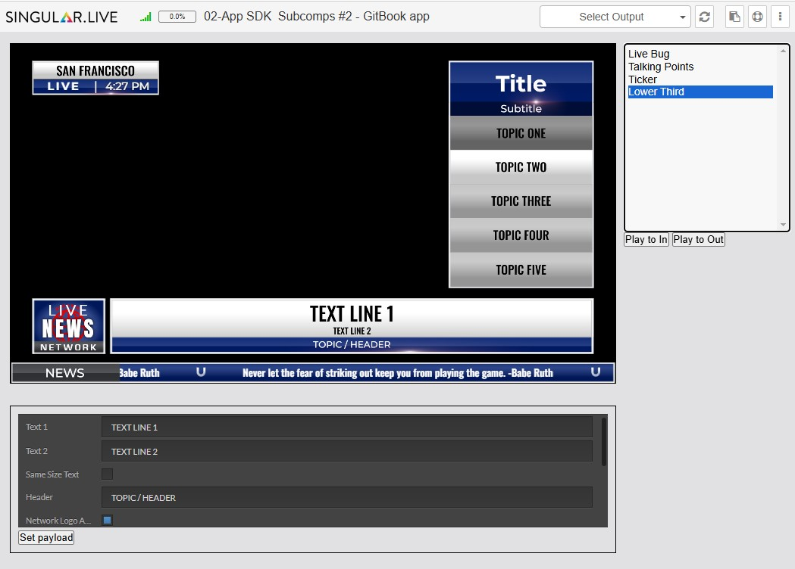
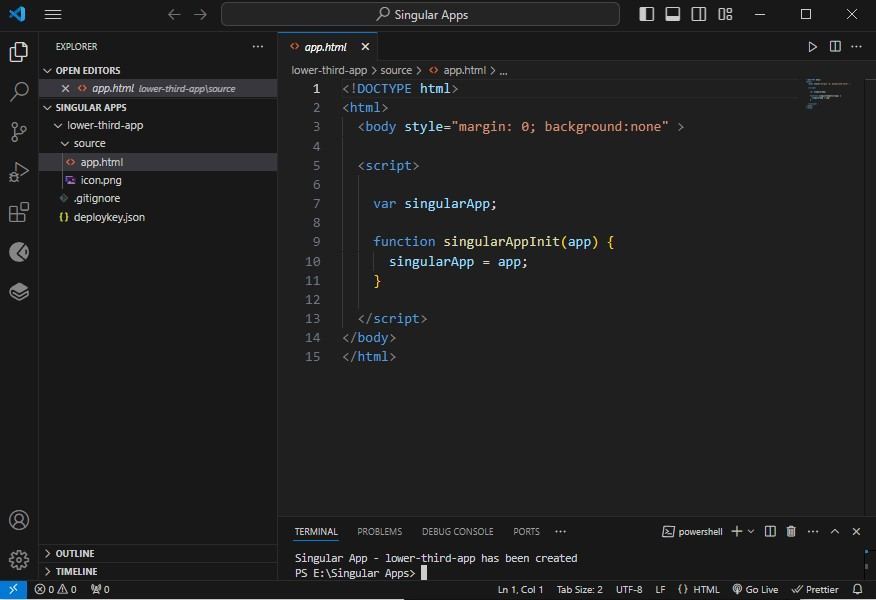
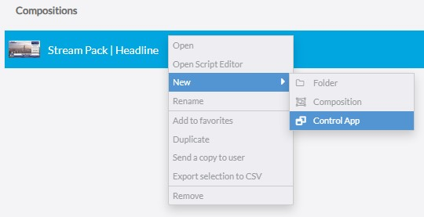
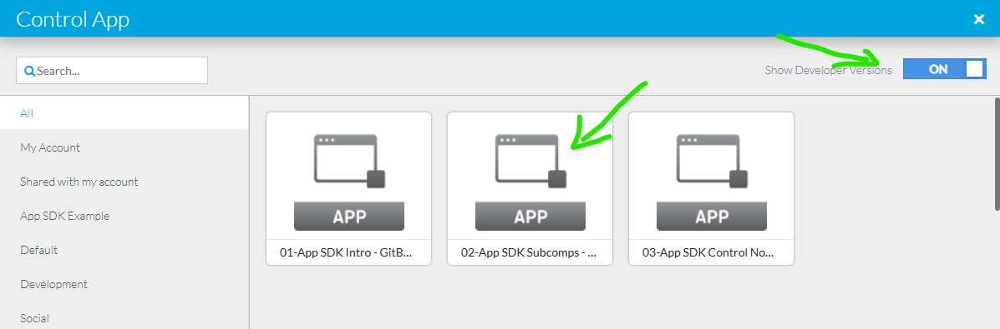

# Subcomposition and Fill-in Form

This example addresses the following App SDK methods:

* Load JavaScript libraries:
  * singularapp.js library (required for local development)
  * singulargraphics.js library (required for local preview)
  * firebase.js library (required for accessing the storage object in local development)
* Initialize the singularApp object
* Get the output object
* Get main composition object
* Get subcomposition objects
* Trigger animations
* Load Singular native fill-in forms
* Register a storage object callback
* Update and read the storage object
* Develop and debug your app locally
* Deploy your app to your Singular account

<figure><figcaption><p>App SDK Example</p></figcaption></figure>

## Step 1: Create a New App in your Account

Follow the steps described in "[Get started](../get-started.md)" to create a new app in your Singular account.

Step2: Download the App boilerplate

## Step 2: Download the App boilerplate

Enter the command `singular createapp subcomposition-app` in the console or a Terminal in Visual Studio Code.

```
PS E:\Singular Apps> singular createapp subcomposition-app
Singular App - subcomposition-app has been created
PS E:\Singular Apps>
```

This command creates the required folder structure and the downloads the app boilerplate.

<figure><figcaption><p>Boilerplate in Visual Studio Code</p></figcaption></figure>

## Step 3: App code for local testing

<details>

<summary>app.html - code for local testing and debugging</summary>

```html
<!-- 
	02-App SDK  Subcomps - GitBook
	- read subcompositions
	- update button
  - animation in/out buttons
  - output in iFrame
  - load Singular fill-in forms
-->
<!DOCTYPE html>
<html>

<head>
  <meta charset="UTF-8">
  <style>
    * {
      margin: 0;
      padding: 0;
      box-sizing: border-box;
    }

    .container {
      max-width: 1200px;
      margin: auto;
      padding: 15px;
    }

    #loader {
      width: 100%;
      height: 100%;
      background-color: black;
      position: absolute;
      z-index: 10000;
      opacity: 0.8;
      display: flex;
      justify-content: center;
      align-items: center;
    }

    select {
      width: 220px;
      height: 250px;
      padding: 5px;
      font-size: 14px;
      border: 1px solid #ccc;
      border-radius: 4px;
      background-color: #f8f8f8;
    }

    .flex-row {
      display: flex;
      gap: 10px;
    }

    .iframe-container {
      width: 800px;
      height: 450px;
      background-color: black;
      border: solid 1px black;
    }

    .sidebar {
      display: flex;
      flex-direction: column;
      align-items: flex-start;
    }

    .payload-container {
      border: solid 1px black;
      margin-top: 25px;
      width: 800px;
      padding: 10px;
    }
  </style>
  <!-- Load to use the Singular App SDK Library -->
  <!-- Required for local development to run and test a Singular App on a local PC -->
  <script src="https://app.singular.live/libs/singularapp/1.0.0/singularapp.js"></script>

  <!-- Load to use the Singular Graphics SDK Library -->
  <!-- Required for running a local instance of the Singular render engine -->
  <!-- <script src="https://app.singular.live/libs/singulargraphics/1.0.0/singulargraphics.js"></script> -->

  <!-- Load the Firebase JavaScript Library -->
  <!-- Required for local development when using the App SDK storage feature -->
  <script src="https://www.gstatic.com/firebasejs/4.9.0/firebase.js"></script>
</head>

<body style="background:#e1e1e2">

  <div id='loader'>
    
  </div>

  <div class="container">
    <div class="flex-row">
      <div>
        <iframe id='output' class="iframe-container"></iframe>
      </div>
      <div class="sidebar">
        <select multiple id='subcompositions' onchange='selectSubcomposition()'></select>
        <div>
          <button onclick='playAnimationTo("In")'>Play to In</button>
          <button onclick='playAnimationTo("Out1")'>Play to Out</button>
        </div>
      </div>
    </div>

    <div class="payload-container">
      <div id='payload' style="display: none;"></div>
      <button onclick="setPayload()">Set payload</button>
    </div>
  </div>

  <script>
    var singularApp;
    var output;
    var composition;
    var payload;
    var subcompositions;
    var selectedSubcomposition;

    /******************************************************************************
    * REQUIRED FOR DEVELOPMENT to run and test a Singular App on a local PC
    * create app instance with app instance key
    */
    if (!parent || (parent && !parent.runningOnSingularServer)) {
      SingularApp.createWithAppInstanceKey(
        "Mr2jCl76kK7aYInPJiBBxSCGXSgs3qvT", // Virtual App Key (required for local testing)
        "https://app.singular.live/",
        singularAppInit,
        "", // user name (required for Studio App testing)
        "" // password (required for Studio App testing)
      );

      function singularAppInit(app) {
        console.log("singularAppInit() - Called");
        initSingularApp(app);
      }
    } else {
      alert("ERROR: Could not connect to Singular server.");
    }
    /**
     * END REQUIRED FOR DEVELOPMENT
     *****************************************************************************/

    /******************************************************************************
     * REQUIRED FOR DEPLOYING to run a Singular App within the Singular Platform
     * create app instance
     */
    // function singularAppInit(app) {
    //   initSingularApp(app);
    // }
    /**
     * END REQUIRED FOR DEPLOYING
     *****************************************************************************/

    //*** initSingularApp
    function initSingularApp(app) {
      document.getElementById('loader').style.display = 'none';

      singularApp = app;

      // get first output 
      var firstOutputId = singularApp.listOutputs()[0].id;
      output = singularApp.getOutputById(firstOutputId);

      document.getElementById('output').src = output.getUrl();

      // get main composition object
      composition = output.getComposition();
      // get list of subcompositions
      subcompositions = composition.listSubcompositions();

      var subcompositionsDropdown = document.getElementById('subcompositions');
      subcompositionsDropdown.innerHTML = '';

      subcompositions.forEach(function (comp) {
        var option = document.createElement('option');
        option.value = comp.id;
        option.textContent = comp.name;
        subcompositionsDropdown.appendChild(option);
      });

      singularApp.storage.get('selectedSubcompositionId', function (id) {
        if (id) {
          subcompositionsDropdown.value = id;
          selectSubcomposition();
        }
      });
    }

    //*** selectSubcomposition
    function selectSubcomposition() {
      var id = document.getElementById('subcompositions').value;
      selectedSubcomposition = composition.getSubcompositionById(id);
      renderPayload();

      singularApp.storage.set('selectedSubcompositionId', id);
    }

    //*** renderPayload in native Singular fill-in form
    function renderPayload() {
      var hidePayload = true;
      if (selectedSubcomposition) {
        var controlNode = selectedSubcomposition.getControlNode();
        document.getElementById('payload').style.display = 'block';
        singularApp.createSingularForm(window, document.getElementById('payload'), controlNode, function (msg) {
          if (msg.event == 'change')
            payload = msg.payload;
        });
        hidePayload = false;
      }

      if (hidePayload) {
        singularApp.destroySingularForm(document.getElementById('payload'));
        document.getElementById('payload').style.display = 'none';
      }
    }

    //*** setPayload
    function setPayload() {
      if (selectedSubcomposition && payload) {
        selectedSubcomposition.setPayload(payload);
      }
    }

    //*** playAnimationTo
    function playAnimationTo(state) {
      if (selectedSubcomposition) {
        selectedSubcomposition.playTo(state);
      }
    }
  </script>

</body>

</html>
```

</details>

## Step 4: App code for deploying

Enter the command `singular deployapp subcomposition-app` in the console or a Terminal in Visual Studio Code to upload the app code to your account in the Singular cloud.

```
PS E:\Singular Apps> singular deployapp subcomposition-app
Singular.Live app deploy
Validating files in directory ./.\subcomposition-app\/source
INFO: api.info not found
INFO: api.js not found
INFO: api.json not found
Creating zip file
Deploying app to Singular.Live
App ID: 63 successfully deployed
PS E:\Singular Apps>
```

<details>

<summary>app.html - code for deploying to the Singular cloud</summary>

```html
<!-- 
	02-App SDK  Subcomps - GitBook
	- read subcompositions
	- update button
  - animation in/out buttons
  - output in iFrame
  - load Singular fill-in forms
-->
<!DOCTYPE html>
<html>

<head>
  <meta charset="UTF-8">
  <style>
    * {
      margin: 0;
      padding: 0;
      box-sizing: border-box;
    }

    .container {
      max-width: 1200px;
      margin: auto;
      padding: 15px;
    }

    #loader {
      width: 100%;
      height: 100%;
      background-color: black;
      position: absolute;
      z-index: 10000;
      opacity: 0.8;
      display: flex;
      justify-content: center;
      align-items: center;
    }

    select {
      width: 220px;
      height: 250px;
      padding: 5px;
      font-size: 14px;
      border: 1px solid #ccc;
      border-radius: 4px;
      background-color: #f8f8f8;
    }

    .flex-row {
      display: flex;
      gap: 10px;
    }

    .iframe-container {
      width: 800px;
      height: 450px;
      background-color: black;
      border: solid 1px black;
    }

    .sidebar {
      display: flex;
      flex-direction: column;
      align-items: flex-start;
    }

    .payload-container {
      border: solid 1px black;
      margin-top: 25px;
      width: 800px;
      padding: 10px;
    }
  </style>
  <!-- Load to use the Singular App SDK Library -->
  <!-- Required for local development to run and test a Singular App on a local PC -->
  <!-- <script src="https://app.singular.live/libs/singularapp/1.0.0/singularapp.js"></script> -->

  <!-- Load to use the Singular Graphics SDK Library -->
  <!-- Required for running a local instance of the Singular render engine -->
  <!-- <script src="https://app.singular.live/libs/singulargraphics/1.0.0/singulargraphics.js"></script> -->

  <!-- Load the Firebase JavaScript Library -->
  <!-- Required for local development when using the App SDK storage feature -->
  <!-- <script src="https://www.gstatic.com/firebasejs/4.9.0/firebase.js"></script> -->
</head>

<body style="background:#e1e1e2">

  <div id='loader'>
    
  </div>

  <div class="container">
    <div class="flex-row">
      <div>
        <iframe id='output' class="iframe-container"></iframe>
      </div>
      <div class="sidebar">
        <select multiple id='subcompositions' onchange='selectSubcomposition()'></select>
        <div>
          <button onclick='playAnimationTo("In")'>Play to In</button>
          <button onclick='playAnimationTo("Out1")'>Play to Out</button>
        </div>
      </div>
    </div>

    <div class="payload-container">
      <div id='payload' style="display: none;"></div>
      <button onclick="setPayload()">Set payload</button>
    </div>
  </div>

  <script>
    var singularApp;
    var output;
    var composition;
    var payload;
    var subcompositions;
    var selectedSubcomposition;

    /******************************************************************************
    * REQUIRED FOR DEVELOPMENT to run and test a Singular App on a local PC
    * create app instance with app instance key
    */
    // if (!parent || (parent && !parent.runningOnSingularServer)) {
    //   SingularApp.createWithAppInstanceKey(
    //     "Mr2jCl76kK7aYInPJiBBxSCGXSgs3qvT", // Virtual App Key (required for local testing)
    //     "https://app.singular.live/",
    //     singularAppInit,
    //     "", // user name (required for Studio App testing)
    //     "" // password (required for Studio App testing)
    //   );

    //   function singularAppInit(app) {
    //     console.log("singularAppInit() - Called");
    //     initSingularApp(app);
    //   }
    // } else {
    //   alert("ERROR: Could not connect to Singular server.");
    // }
    /**
     * END REQUIRED FOR DEVELOPMENT
     *****************************************************************************/

    /******************************************************************************
     * REQUIRED FOR DEPLOYING to run a Singular App within the Singular Platform
     * create app instance
     */
    function singularAppInit(app) {
      initSingularApp(app);
    }
    /**
     * END REQUIRED FOR DEPLOYING
     *****************************************************************************/

    //*** initSingularApp
    function initSingularApp(app) {
      document.getElementById('loader').style.display = 'none';

      singularApp = app;

      // get first output 
      var firstOutputId = singularApp.listOutputs()[0].id;
      output = singularApp.getOutputById(firstOutputId);

      document.getElementById('output').src = output.getUrl();

      // get main composition object
      composition = output.getComposition();
      // get list of subcompositions
      subcompositions = composition.listSubcompositions();

      var subcompositionsDropdown = document.getElementById('subcompositions');
      subcompositionsDropdown.innerHTML = '';

      subcompositions.forEach(function (comp) {
        var option = document.createElement('option');
        option.value = comp.id;
        option.textContent = comp.name;
        subcompositionsDropdown.appendChild(option);
      });

      singularApp.storage.get('selectedSubcompositionId', function (id) {
        if (id) {
          subcompositionsDropdown.value = id;
          selectSubcomposition();
        }
      });
    }

    //*** selectSubcomposition
    function selectSubcomposition() {
      var id = document.getElementById('subcompositions').value;
      selectedSubcomposition = composition.getSubcompositionById(id);
      renderPayload();

      singularApp.storage.set('selectedSubcompositionId', id);
    }

    //*** renderPayload in native Singular fill-in form
    function renderPayload() {
      var hidePayload = true;
      if (selectedSubcomposition) {
        var controlNode = selectedSubcomposition.getControlNode();
        document.getElementById('payload').style.display = 'block';
        singularApp.createSingularForm(window, document.getElementById('payload'), controlNode, function (msg) {
          if (msg.event == 'change')
            payload = msg.payload;
        });
        hidePayload = false;
      }

      if (hidePayload) {
        singularApp.destroySingularForm(document.getElementById('payload'));
        document.getElementById('payload').style.display = 'none';
      }
    }

    //*** setPayload
    function setPayload() {
      if (selectedSubcomposition && payload) {
        selectedSubcomposition.setPayload(payload);
      }
    }

    //*** playAnimationTo
    function playAnimationTo(state) {
      if (selectedSubcomposition) {
        selectedSubcomposition.playTo(state);
      }
    }
  </script>

</body>

</html>
```

</details>

### Create an app instance in your Dashboard

Use the right-mouse button menu and select "New -> Control App".

<figure><figcaption><p>Create App Instance for a Composition</p></figcaption></figure>

### Select your App in the App Browser

* Activate "Show Developer Versions" to select the development version with the newest uploaded code.&#x20;

<figure><figcaption><p>Control App Browser</p></figcaption></figure>

## App instance URL for testing

* Shared App URL: [https://app.singular.live/control/1GI619ibZs5D5eDUjVoxsu](https://app.singular.live/control/1GI619ibZs5D5eDUjVoxsu)
* Output URL: [https://app.singular.live/output/23co07wtmiQVhIYUig9et4/Default?aspect=16:9](https://app.singular.live/output/23co07wtmiQVhIYUig9et4/Default?aspect=16:9)
