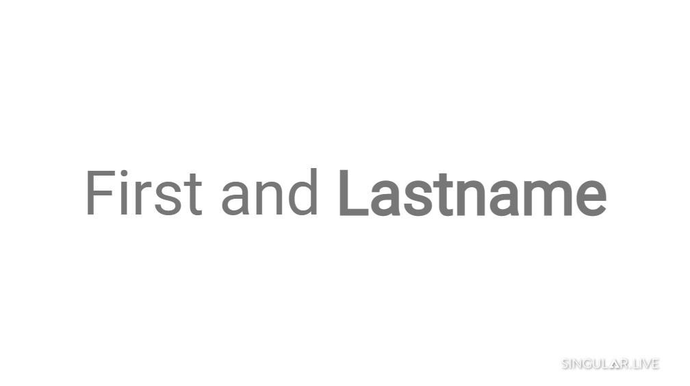

# Read control nodes and generate HTML text

This example explains how to read control nodes and use the text widget’s HTML feature to style text.

<figure><figcaption><p>Screenshot</p></figcaption></figure>

### Widget used

* [Text widget](https://support.singular.live/hc/en-us/articles/360025486472-Text-Widget)

### Functions covered

* [comp.findWidget()](https://developer.singular.live/composition-scripting/cheat-sheets/fundamentals#findwidget)
* [comp.getPayload2()](https://developer.singular.live/composition-scripting/cheat-sheets/fundamentals#getpayload2)
* [widget.setPayload()](https://developer.singular.live/composition-scripting/cheat-sheets/fundamentals#setpayload-1)

Load this [example composition](https://app.singular.live/compositions/458984/edit) to follow along in a real composition.

### Composition structure

The composition has one sub-composition called **Lower**, as you can see in the composition tree.

<figure><figcaption><p>The Lower sub-composition</p></figcaption></figure>

To see this sub-composition's widgets:

1. [Open the composition script editor](../composition-script-editor-reference.md#accessing-the-composition-script-editor) within the same [example composition](https://app.singular.live/dashboard?templateLibraryItem=829) as above and select the **Lower composition script**.
2. In the composition navigator, select the **Widget Explorer** tab.

This composition contains three widgets, but for this quick start, you'll look at the text widget, which in the composition is called **lowerFullname**.

<figure><figcaption></figcaption></figure>

### Composition script

Now that you have located the composition's text widget, learn how to use the text widget’s HTML feature to style text and set a background color in the Lower composition script.

You can also copy and paste the composition script below into your own compositions.


```javascript
(function() {

  const HTML_TEMPLATE = "<html>{{firstname}} <b>{{lastname}}</b></html>";

  return {

    init: function(comp, context) {

      // get reference to the fullname widget
      const wiLowerFullname = comp.findWidget("lowerFullname")[0];

      /**********************************************************************/

      // we define a function to update the composition
      function updateComposition() {
        // get control node payload as JSON object
        const p = comp.getPayload2();
        console.log(p);

        // build HTML text.
        let htmlFullname = HTML_TEMPLATE.replace("{{firstname}}", p["Firstname"]);
        htmlFullname = htmlFullname.replace("{{lastname}}", p["Lastname"]);

        // update fullname text
        wiLowerFullname.setPayload({
          "text": htmlFullname
        });

      }

      /**********************************************************************/

      // we listen to payload_changed events
      comp.addListener('payload_changed', (event, msg, e) => {
        updateComposition();
        e.stopPropagation();
      });

      /**********************************************************************/

      // update the composition when loading the output URL
      updateComposition();

    },

    close: function(comp, context) {}
  };
})();

```


### Singular control app


Read control nodes, generate HTML styled text app

