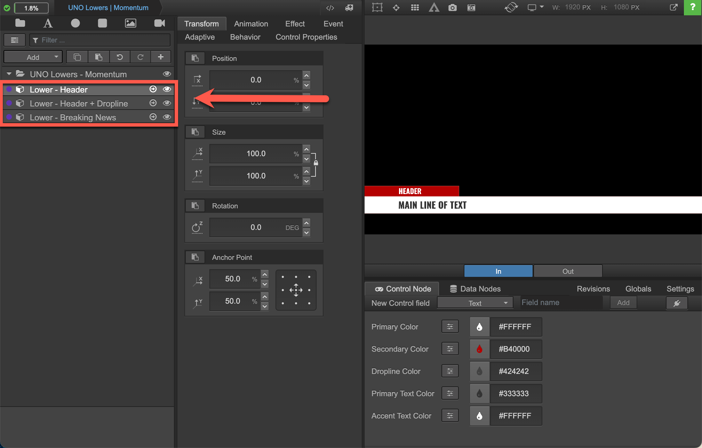

# Building overlays in Composer

The [Overview of Singular section](../overview-of-singular.md) describes the basics of compositions, or files that contain the makeup of overlays. Here we'll take a closer look at the elements that make up a composition.

### Sub-compositions

Every composition is made up of one or more sub-compositions, which in turn consist of widgets, groups of widgets, and even other sub-compositions. When nested within a parent sub-composition, these create an overlay.&#x20;

For example, this composition has three sub-compositions, each of which makes up an overlay.

<figure><figcaption>
Sub-compositions in a composition
</figcaption></figure>

When you click into a sub-composition, you can see the groups and widgets that make up the sub-composition. In the next screenshot, you can see the name of the sub-composition in the [composition breadcrumb](composer-reference.md#1.1-composition-breadcrumb) (1) and the sub-composition's groups and widgets in the [composition tree](composer-reference.md#1.-composition-tree) (2).

<figure><figcaption>
A sub-composition and its groups and widgets
</figcaption></figure>

Your first step when building a new composition should be to create separate sub-compositions for each overlay within your root group folder. Then, you'll nest the widgets required to build each overlay within them.

By grouping elements together within a sub-composition, you can add controls, effects, and animations to all widgets in that sub-composition. For example, instead of having the same animation for three separate sub-compositions, you can tie one animation to a single sub-composition containing your three elements.

### Logic layers

A logic layer is an overlay category that can be assigned to sub-compositions in the composition navigator in Composer. Sub-compositions assigned to the same logic layer can't be in the In state at the same time. That means that if you send a sub-composition on air, any other sub-compositions assigned to the same logic layer will automatically be sent off air. This prevents sub-compositions from interfering with each other on air.

<figure><figcaption>
Logic layers defined for a composition in Composer
</figcaption></figure>

### The architecture of Singular compositions

A composition has four parts:&#x20;

* Widgets
* Control nodes
* Data nodes
* Composition scripts

<figure><figcaption>
Composition architecture
</figcaption></figure>

To understand what each part does and how they work together in a composition, let’s look at each one.

### **Widgets**

Widgets are the basic building blocks of compositions. You might start building a sub-composition by creating a rectangle widget and modifying its color, size, scale, and position. Then you might put a text widget in front of it and modify its font, size, and color. From there, you can create a whole collection of sub-compositions to make up one composition that contains all the overlays you need for a show.

<figure><figcaption>
Widget library
</figcaption></figure>

Widgets come in two categories: basic and advanced.

#### **Basic widgets**

Basic widgets come with a simple set of properties and straightforward options.

Examples of basic widgets:

* Text
* Circle
* Rectangle
* Image
* Video

<figure><figcaption>
An overlay built with basic widgets
</figcaption></figure>

**Advanced widgets**

Advanced widgets are usually dependent on additional compositions in order to function. They also require data or code to work.

Examples of advanced widgets:

* Grid
* Table
* Video playlist
* Google line chart
* Google pie chart

<figure><figcaption>
An overlay made with an advanced table widget
</figcaption></figure>


The widget library has a large collection of widgets, but you can also create new widgets with the Singular Widget SDK.


### **Control nodes**

Control nodes make certain widget properties, like text, images, colors, and more, available to be controlled by applications like Studio and UNO, or the Singular APIs. This allows you to dynamically modify widgets without having to go into the composition itself in Composer. The scope of a control node is limited to one app instance of the linked composition.

<figure><figcaption>
Control nodes set up so that cryptocurrencies can be updated using Singular's REST API
</figcaption></figure>

### **Data nodes**

Like control nodes, data nodes link specific widget properties to control applications like Studio and UNO, or the Singular APIs. The difference between control nodes and data nodes is that while control nodes are limited to one app instance of the linked composition, the scope of a data node is global within a Singular account. This means that you can use a single data node to update multiple compositions simultaneously.

### **Composition scripts**

Singular overlays are HTML webpages that are placed over videos. With composition scripting, you can add JavaScript layers to HTML overlays. This allows you to extend the functionality of your compositions and add logic to them so that they automatically update according to the rules set up in a composition script.&#x20;

For example, you might add composition scripting to an auto racing overlay so that as it receives real-time data about the positioning of the cars, the drivers’ positions move up and down a leader board. Or in a football overlay, you can set up an animation to play whenever a team scores a point.

Composer includes a built-in composition script editor, allowing you to test the functionality of your composition scripts directly in your composition's output rather than deploying any code to your web environment.

<figure><figcaption>
Composition scripts linking data to an overlay
</figcaption></figure>

