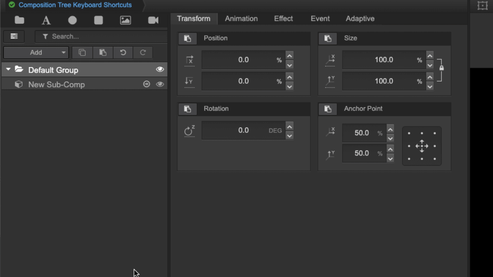
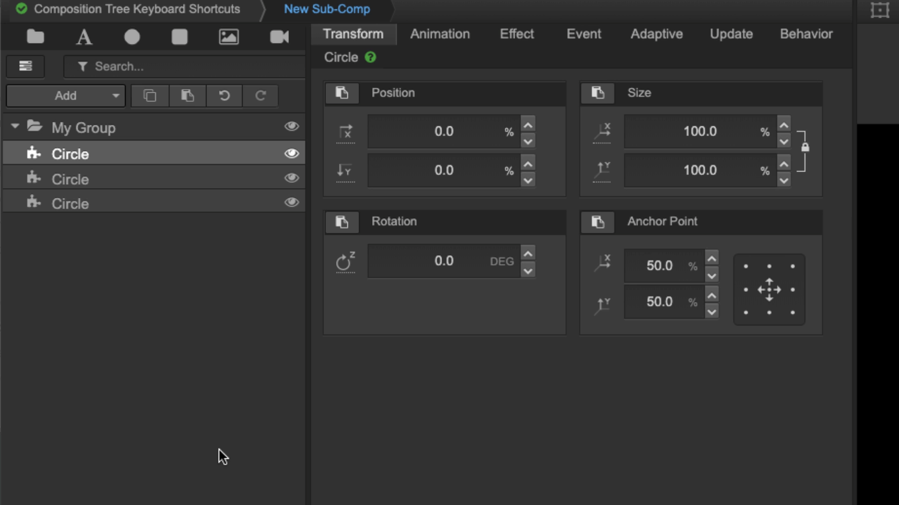
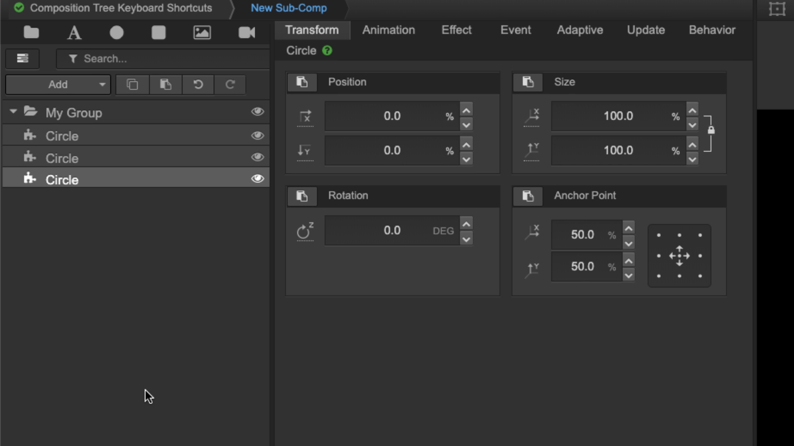
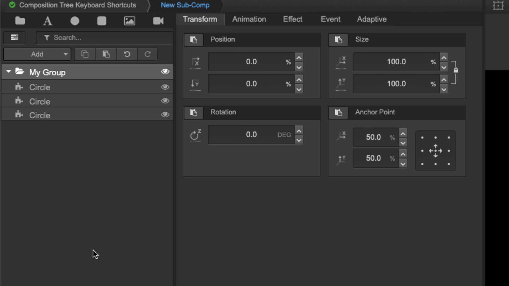
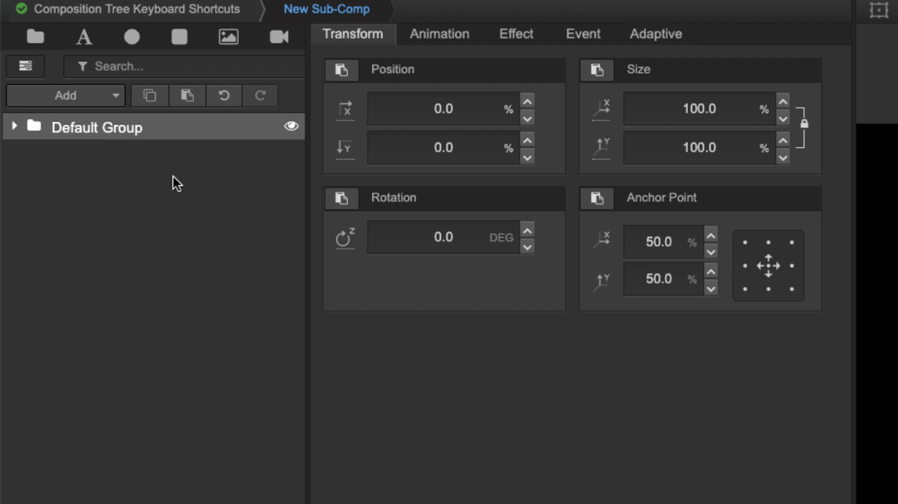

# Composer reference

Singular’s overlay builder, Composer, is where you create and edit custom HTML5 overlays. On this page, you'll find an overview of the layout of Composer and and a list of Composer shortcut hotkeys.

* [Composer layout](composer-reference.md#composer-layout)
* [Composer shortcuts](composer-reference.md#composer-shortcuts)

## Composer layout

### The main areas of Composer

Composer contains four main areas:

1. Composition tree
2. Property panel
3. Output window
4. Data interface and control panel

<figure><figcaption>
Main areas of Composer
</figcaption></figure>

#### 1. Composition tree

This panel shows the organizational structure of the elements in a composition or sub-composition.

#### 2. Property panel

Here, various editors are available to modify and change the parameters of a selected widget, group, or sub-composition.

#### 3. Output window

In this panel, you can preview overlays.

#### 4. Data interface and control panel

This panel allows you to define links to external data and specify widget properties you want to expose to external control applications or the Singular APIs.

### A closer look at each area of Composer

<figure><figcaption>
A closer look at Composer
</figcaption></figure>

#### Areas of the composition tree

**1.1 Composition breadcrumb**

Here you can see the size and name of the composition you are working on.

**1.2 Composition tree toolbar**

This toolbar allows you to add, copy, and paste elements, such as widgets, groups, and sub-compositions, into a composition. It also contains a search bar, undo/redo buttons, open/close all groups buttons, and the composition navigator button.

**1.3 Composition navigator**

This floating user interface is for navigating between sub-compositions within a composition. Here you can trigger in and out timeline animations, assign a sub-composition to a logic layer, and adjust transition timers. Access it by selecting the composition navigator button in the composition tree toolbar or by using the shortcut command + F (Mac) or control + F (PC).

#### Areas of the property panel

**2.1 Composition script editor**

Above the property panel is a button to open the composition script editor and another to open the composition script editor in safe mode.

#### Areas of the output window

**3.1 Preview toolbar**

In this toolbar within the output window, you can turn on/off bounding boxes, choose the aspect ratio of the device or the composition you want to build for, take a thumbnail snap of the frame, or open a new tab to see the output of your work on a clean page.

**3.2 In and Out buttons**

These buttons trigger In and Out animations.

**3.3 Singular support button**

The support button opens the Singular Support widget.

## Composer shortcuts

### General composer shortcuts

The following general Composer shortcuts are shown next to the menu items or as tool tips (accessed by hovering over):

<figure><figcaption>
Adding a group, widget, or sub-composition
</figcaption></figure>

<figure><figcaption>
Undo shortcut
</figcaption></figure>

* **CMD/CTRL + G**: Add a new group
* **CMD/CTRL + B**: Add a new widget
* **CMD/CTRL + S**: Add a new sub-composition
* **CMD/CTRL + F**: Open the composition navigator
* **CMD/CTRL + X**: Cut
* **CMD/CTRL + C**: Copy
* **CMD/CTRL + V**: Paste
* **CMD/CTRL + Z**: Undo
* **CMD/CTRL + Y**: Redo

### Composition tree navigation shortcuts

Composition tree navigation shortcuts are not shown in the UI. To activate them, click on the composition tree. They allow you to navigate through the composition tree quickly and easily:

* Right, left, up, and down cursors
* Enter
* Space bar
* H

#### Right, left, up and down cursors

These arrow keys allow you to select tree elements

**Right**

Moves from a group to the first child element. If the selected element is a sub-composition, the right key will open this sub-composition and select the first element.

<figure><figcaption>
Right
</figcaption></figure>

**Left**

Moves from an element to its group and then to its parent composition.

<figure><figcaption>
Left
</figcaption></figure>

**Up**

Moves up, vertically, within that section of the tree.

<figure><figcaption></figcaption></figure>

**Down**

Moves down, vertically, within that section of the tree.

<figure><figcaption>
Down 
</figcaption></figure>

#### Addition composition tree shortcuts

**Enter**

Changes the selected element name.

<figure><figcaption>
Enter
</figcaption></figure>

**Space bar**

Opens and closes the selected group.

<figure><figcaption>
Space bar
</figcaption></figure>

**H key**

Toggles visibility of the selected element.

<figure><figcaption>
H key
</figcaption></figure>

