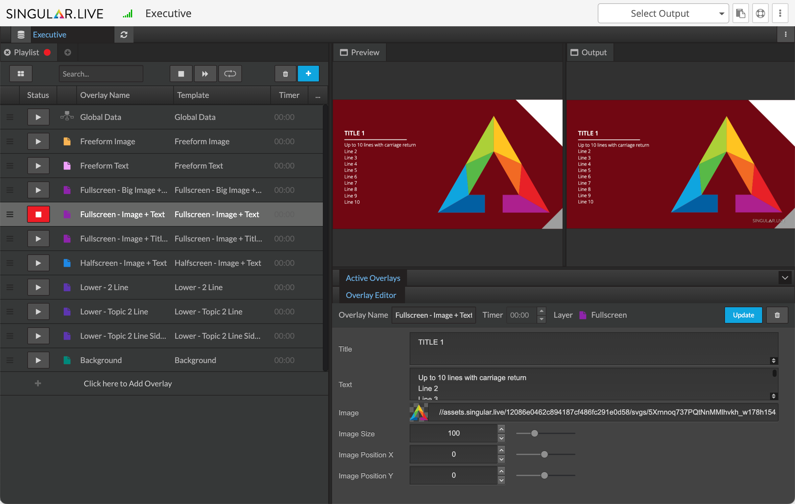
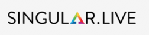

# Studio reference

Singular Studio is a control application that allows you to add content to templates and custom compositions, create playlists for them, and output overlays.

<figure><figcaption>
Studio control application
</figcaption></figure>

### Main sections of Studio

* [Preview window](studio-reference.md#preview-window)
* [Output window](studio-reference.md#output-window)
* [Playlist panel](studio-reference.md#playlist-panel)
* [Control bar](studio-reference.md#control-bar)
* [Overlay editor](studio-reference.md#overlay-editor)
* [Active overlays panel](studio-reference.md#active-overlays-panel)
* [Playlist bar](studio-reference.md#playlist-bar)
* [Home button](studio-reference.md#home-button)

#### Preview window

This window displays a preview of the selected overlay.

<figure><figcaption>
Preview window
</figcaption></figure>

#### Output window

This window is where you can view your On Air overlays. These are the overlays that your audience will see.

<figure><figcaption>
Output window
</figcaption></figure>

#### Playlist panel

Overlays that you add from your composition can be found here. They appear in whatever playlist you have selected.

<figure><figcaption>
Playlist panel
</figcaption></figure>

#### Control bar

This bar houses key playlists controls like adding overlays or automating options.

<figure><figcaption>
 Control bar
</figcaption></figure>

#### Overlay editor

Overlays from a composition typically have elements that can be edited. Depending on the overlay contents, the editable fields in this panel will change.

<figure><figcaption>
Overlay editor
</figcaption></figure>

#### Active overlays panel

This collapsible panel shows you which overlay is active for each layer. Clicking on the layer will toggle the overlay On and Off Air.&#x20;

<figure><figcaption>
Active overlays panel
</figcaption></figure>

#### Playlist bar

This bar is where you create, manage, activate, and deactivate playlists.

<figure><figcaption>
Playlist bar
</figcaption></figure>

#### Home button

The Singular.live logo button on the top left navigates you back to your Dashboard.

<figure><figcaption>
Home button
</figcaption></figure>

### Fundamental elements of Studio

The fundamental Studio elements are: the connect and refresh composition button, add and delete playlist button, add and delete overlay button, automating playlist buttons, active overlay, overlay in/out buttons, editable overlay elements, add overlay timer, update and delete overlay, copy url button, studio help button, and the studio settings button.

#### Connect and refresh composition

Above the playlist panel are two buttons. The one to the left allows you to connect or re-connect a composition to your Studio show. The button on the right allows you to reload the composition, which is useful when changes have been made to your connected composition.

<figure><figcaption>
Connect and refresh composition
</figcaption></figure>

#### Add and delete playlist

Clicking the X button next to a playlist deletes it while clicking the + button creates a new one.

<figure><figcaption>
Add and delete playlist
</figcaption></figure>

#### Add and delete overlay

These buttons allow you to add and delete overlays that have been added to a playlist in the playlist panel.

<figure><figcaption>
Add and delete overlay
</figcaption></figure>

#### Automating playlist buttons

These buttons (from left to right) tell overlays with timers in the selected playlist tab to stop, auto-advance, or play in a loop. Using auto-advance plays through the timed overlays once.

<figure><figcaption>
Automating playlist buttons
</figcaption></figure>

#### Active overlay

When you select an overlay in the playlist panel, you can change the editable fields in the overlay editor. The overlay will also appear in the preview window.

<figure><figcaption>
Active overlay
</figcaption></figure>

#### Overlay IN/OUT buttons

This button next to each overlay toggles the overlay On or Off Air in the output window.

<figure><figcaption>
Overlay IN/OUT buttons
</figcaption></figure>

#### Editable overlay elements

These sections in the overlay editor are examples of content that is editable within your overlays. In this example, you can change the overlay name as well as the title, timer, logos in your overlay, and more.

<figure><figcaption>
Editable overlay elements
</figcaption></figure>

#### Add overlay timer

In the overlay editor, you can add a timer to an overlay. Having timed overlay allows you to automate overlays in a playlist.

<figure><figcaption>
Add overlay timer
</figcaption></figure>

You can also add a timer to an overlay in the playlist panel by double-clicking on the timer area on the right.

<figure><figcaption>
Playlist panel timer
</figcaption></figure>

#### Update overlay, delete overlay

In Singular, you can edit the contents of an overlay while it's On Air but the overlay itself won't change. For the On Air overlay to update with the change in information, you'll have to hit the blue update button in the top right portion of the Overlay Editor.

You can also select the trashcan button to the right to delete the selected overlay.

<figure><figcaption>
Update or delete overlay
</figcaption></figure>


If you have created a control node in Composer and checked **Immediate Update** in its settings, the contents of that control field will automatically updates in Studio without having to hit the blue update button.


#### Copy URL button

Select this button to copy your output URL. Learn more about outputting with Singular [here](https://support.singular.live/hc/en-us/articles/360000551532-Outputting-Overview).

<figure><figcaption>
Copy URL button
</figcaption></figure>

#### Studio help button

This button is where you can access the Singular Support Portal for help resources.

<figure><figcaption>
Studio help button
</figcaption></figure>

#### Studio settings button

This button is a dropdown menu of the following options:

* Output URL
* Embed code
* Manage access
* Preview settings
* Developer tools

<figure><figcaption>
Studio settings button
</figcaption></figure>
