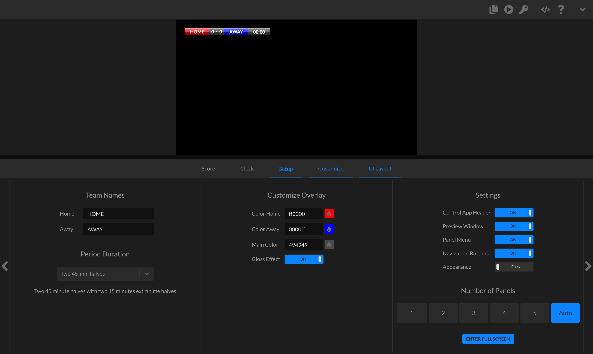
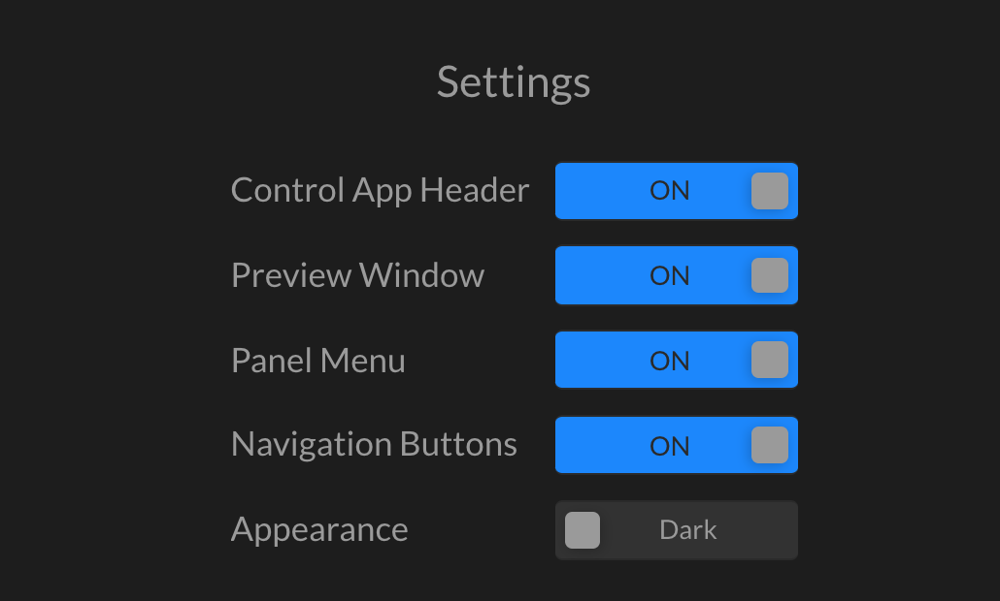

# UNO reference

Each template in the UNO is designed to do one thing and do it brilliantly.

<figure><figcaption>
UNO UI
</figcaption></figure>

In contrast with Studio's playlist-centric operation environment, UNO template interfaces have optimal operation environments for single overlays (i.e. a soccer scorebug or countdown clock).

## User interface

### Output window

<figure><figcaption>
 Output window
</figcaption></figure>

### Control panels

#### Customize

The customize panel allows you to customize pre-defined elements of an overlay's style. These properties vary with each overlay but frequently contain color and effects settings.

<figure><figcaption>
Customize overlay
</figcaption></figure>

#### UI layout

The UI layout panel contains two types of modifiable properties: settings and number of panels.

**Settings**

<figure><figcaption>
Settings
</figcaption></figure>

**Number of panels**

* Number selector: where you can select the number of visible panels. Auto displays the number of panels based on operator screen size.
* ENTER FULLSCREEN: pushes the UI into fullscreen mode.

<figure><figcaption>
Number of panels
</figcaption></figure>

### Various unique control panels

#### Menu

<figure><figcaption>
Menu
</figcaption></figure>

From left to right:

* Output URL: Final overlay/graphic output for use in production software like OBS.
* Control URL: URL to access the control interface of the template. It can be used in OBS to dock the interface.
* Access token: Advanced token for external software app access.&#x20;
* API description: Information on the API.
* Help article: Unique template support article.
* Expand/collapse output window: Hide or show output window in the UI.

#### Going live

<figure><figcaption>
 Going live
</figcaption></figure>

Copy the output URL in the menu and paste as a browser layer/source into the production software of your choosing or use in API calls.

#### Using on mobile

Copy the control URL and send to your mobile device for control.

<figure><figcaption>
Using on mobile
</figcaption></figure>

