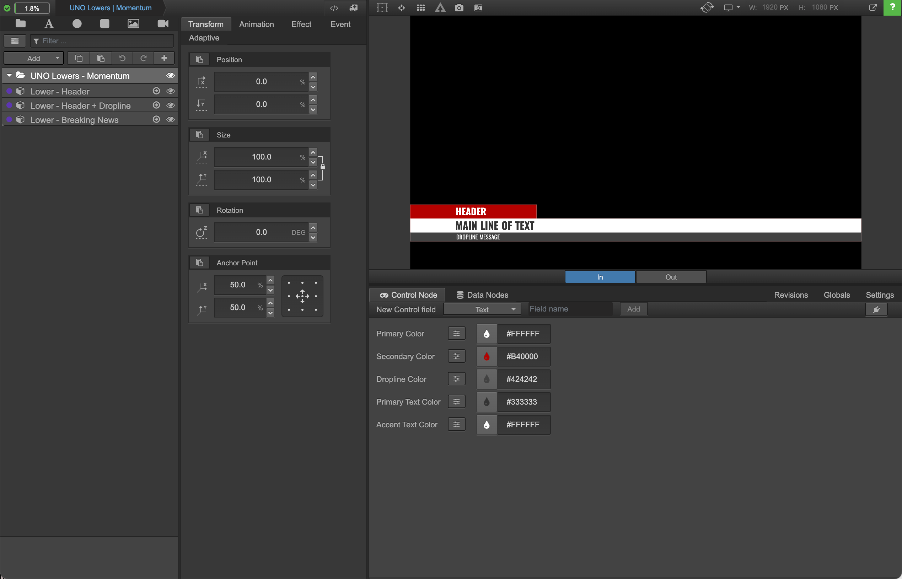
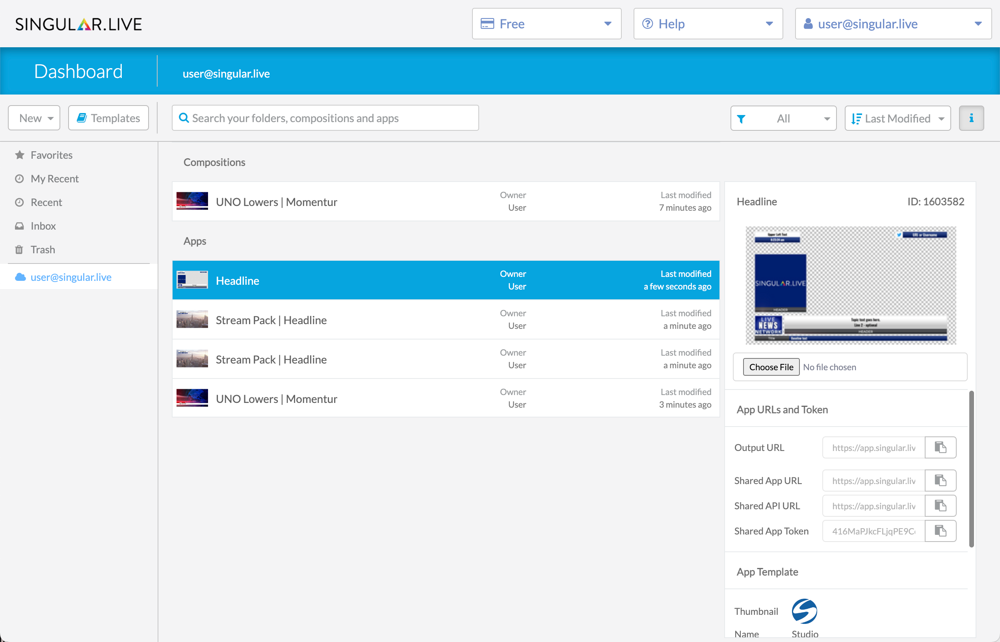

# Overview of Singular

This page walks you through the essential concepts, workflow, and Singular platforms you need to know about to get started with Singular.

Start by creating or logging into your account at [Singular.live](http://www.singular.live).

### Compositions and apps

In Singular, a file that contains the _make-up_ of an overlay, or a suite of overlays, is called a composition.&#x20;

A file that contains the _content_ of an overlay, or a suite of overlays, including their text, images, animations, and playlists, is called an app.

#### Compositions

A composition typically contains a group of overlays called sub-compositions and all the information about their structure and attributes, including their shape, size, color, and placement, plus the fonts used in any text blocks, how they animate in and out, and more.

Sub-compositions are built and updated in Composer using a library of customizable [widgets](../support/singular-terminology.md#widget) for each element. By setting up a [logic layer](../support/singular-terminology.md#logic-layer), sub-compositions of the same type or in the same position on the screen automatically replace each other instead of overlapping as they are sent on-air. By creating [control nodes](../support/singular-terminology.md#control-node) and/or data nodes, you can make widgets in a sub-composition available to be controlled externally. For example, by setting up a control node for a text widget in a composition, you can update that overlay's text using the Singular REST API.

**Examples of compositions**

* A simple countdown timer
* A suite of overlays for a sports match, complete with a fullscreen match-up, a score bug, panels, a static baseline, social media icons, and more
* A news-themed pack of overlays with a live bug, lower third, talking points panel, and ticker

<figure><figcaption>
A composition in Composer
</figcaption></figure>

#### Apps

Apps, or control apps, are used to control compositions. You can create apps in the Dashboard from compositions that you have created or download app templates from the Singular template library.

Apps allow you to update the content of a composition, including its text, images, animations, and more. They can be controlled with Singular Studio or UNO, the Singular APIs, or third-party apps like OBS and TVU Networks.&#x20;

For every show, you need an [app instance](../support/singular-terminology.md#app-instance). For example, say you have a tennis composition and want to use it for a few different matches. You would create an app instance on the Dashboard for each match. Then you can update each app instance with details about the players, their stats, the location, and more, for each match. This allows you to run multiple shows, including simultaneously, based on the same composition without affecting the original composition.

<figure><figcaption>
An app in Studio with a playlist on the left, a preview on the top right, and text entry fields on the bottom right.
</figcaption></figure>

### **The Singular workflow**

1. The Singular workflow begins on the Dashboard, where you can create a blank composition or download an app template from the template library.
2. From there, you move to Composer to build a composition from scratch or customize the template you downloaded.
3. After building the composition, you create an app for it in the Dashboard.
4. Finally, you add content to the composition and control it in Singular’s Studio or UNO, a third-party app, or by using the Singular APIs.

<figure><figcaption>
The Singular workflow
</figcaption></figure>

### Singular platforms: Dashboard, Composer, Studio, and UNO

Singular has a platform for each part of the workflow, so you can create, control, and share overlays with the optimal toolset for each task. Overlays are managed in Dashboard, built in Composer, and controlled in Studio or UNO, or by using the Singular APIs.


As a developer, you’ll use the Singular APIs to update and control overlays. However, Studio and UNO are still helpful for seeing how overlays perform before you have integrated the APIs into your system.


#### Dashboard

Dashboard is Singular's file manager, where you can create, duplicate, organize, and delete compositions and apps. It also contains information about your account and details about your compositions and apps.

<figure><figcaption>
Dashboard
</figcaption></figure>

Dashboard also includes an extensive **template library**, with overlay themes for entertainment, news, wellness, sports, and more, plus resources like composition scripts and examples from webinars and tutorials.

<figure><figcaption>
Template library
</figcaption></figure>

#### Composer

In Composer, you can build and edit compositions; use control nodes to make widgets within sub-compositions available to be controlled by control apps and the Singular APIs; and add logic layers to coordinate the animation of overlays of the same time or that share the same screen real estate. You can also use Composer to add composition scripts (JavaScript code snippets) to add additional logic to a composition so it automatically updates according to the rules set up in the composition script.

<figure><figcaption>
Composer
</figcaption></figure>

#### Studio

Studio is Singular's standard control application. It allows you to create playlists, add content to  compositions, and take overlays on air.

<figure><figcaption>
Studio controlling a countdown overlay
</figcaption></figure>

#### UNO

The UNO control app controls Singular's UNO family of templates. UNO templates are designed to do one thing and one thing only, so the interface displays only the options applicable to a particular template.&#x20;

<figure><figcaption>
A football template in UNO
</figcaption></figure>

Now that you understand the basics of Singular, go deeper into [managing](managing-overlays-in-the-dashboard/), [building](building-overlays-in-composer/), and [controlling overlays](controlling-overlays-in-studio-and-uno/). Or jump right in and [build your first composition](building-overlays-in-composer/how-to-build-a-composition.md).
