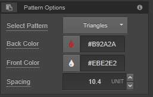
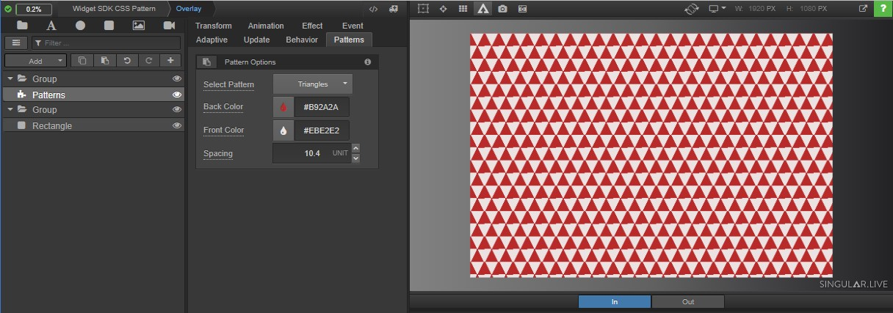

# Widget example: CSS patterns

## **Widget UI**

The widget UI exposes the following properties and groups them in a single card.

<table><thead><tr><th width="164">Name</th><th width="128">Id</th><th width="127">Type</th><th>Description</th></tr></thead><tbody><tr><td>Select Pattern</td><td>patternId</td><td>selection</td><td>Selection of pattern names</td></tr><tr><td>Back Color</td><td>backColorId</td><td>color</td><td>Background color</td></tr><tr><td>Front Color</td><td>frontColorId</td><td>color</td><td>Foreground color</td></tr><tr><td>Spacing</td><td>spacingId</td><td>number</td><td>Spacing between pattern repetitions</td></tr></tbody></table>

<figure><figcaption><p>Widget UI</p></figcaption></figure>

<details>

<summary>UI definition</summary>

```json
{
  "model": {
    "fields": [
      {
        "id": "patternId",
        "type": "selection",
        "title": "Select Pattern",
        "defaultValue": "Rectangles",
        "selections": [
          {
            "id": "Circles",
            "title": "Circles"
          },
          {
            "id": "Rectangles",
            "title": "Rectangles"
          },
          {
            "id": "Triangles",
            "title": "Triangles"
          }
        ]
      },
      {
        "id": "backColorId",
        "type": "color",
        "title": "Back Color",
        "defaultValue": "#E5E5F7"
      },
      {
        "id": "frontColorId",
        "type": "color",
        "title": "Front Color",
        "defaultValue": "#444CF7"
      },
      {
        "id": "spacingId",
        "type": "number",
        "title": "Spacing",
        "defaultValue": "25",
        "min": "1",
        "max": "100",
        "step": "0.1",
        "unit": "unit",
        "format": "0.1"
      }
    ],
    "groups": [
      {
        "id": "group1Id",
        "title": "Pattern Options",
        "width": "single",
        "toolTip": "Select a Pattern and modify options",
        "childIds": ["patternId", "backColorId", "frontColorId", "spacingId"]
      }
    ]
  }
}
```


</details>

## Widget code


The widget loads and uses the tinycolor.js library to convert various color values (RGB, HEX, HSL, RGBA, or HSLA) to HEX color definition.


<details>

<summary>output.html</summary>

```html
<!DOCTYPE html>
<html>
  <head>
    <style>
      /* Default widget style to make output match the bouding box */
      html,
      body {
        background: none;
        margin: 0;
        padding: 0;
        height: 100%;
        overflow: hidden;
      }
      /* Add your custom styles here */
    </style>
  </head>
  <body>
    <!-- Your custom html goes here -->
    <div id="pattern" style="position: absolute; left:0%; top:0%; width: 100%; height: 100%"></div>
    
    <!-- Singular Widget Library -->
    <script src="https://app.singular.live/libs/singularwidget/1.0.4/singularwidget.js"></script>
    <!-- Load tinycolor library from cloudflare cdn -->
    <script src="https://cdnjs.cloudflare.com/ajax/libs/tinycolor/1.5.2/tinycolor.min.js" integrity="sha512-gV2/CUt/1tn0eFseTyMjNqZU3kvhXacxA5eFoTwTd9c4b/Ems0BF00LOG/KcWnGZRdo62tqYNS8IiKtU4PGVoA==" crossorigin="anonymous" referrerpolicy="no-referrer"></script>
    <script>
      let windowWidth = 0;
      let windowHeight = 0;
      let elePattern = undefined;
      let patternChanged = false;
      let pattern = "Rectangles";
      let spacing = 50;
      let bgColor = "#E5E5F7";
      let fgColor = "#444CF7";
      // we define pattern styles in a map
      const patternStyles = {
        "Circles": {
          draw: (params) => {
            const cssBgImage = "radial-gradient(circle at center center, {{fgColor}}, {{bgColor}}), repeating-radial-gradient(circle at center center, {{fgColor}}, {{fgColor}}, {{spacing}}%, transparent {{spacing2x}}%, transparent {{spacing}}%)";
            elePattern.style.backgroundImage = cssBgImage.replaceAll("{{fgColor}}", params.fgColor).replaceAll("{{bgColor}}", params.bgColor).replaceAll("{{spacing2x}}", params.spacing * 2).replaceAll("{{spacing}}", params.spacing);
            elePattern.style.backgroundBlendMode = "multiply";
          }
        },
        "Rectangles": {
          draw: (params) => {
            const cssBackground = "repeating-conic-gradient({{bgColor}} 0% 25%, {{fgColor}} 0% 50%) 50%/{{spacing}}vw {{spacing}}vh";
            elePattern.style.background = cssBackground.replaceAll("{{fgColor}}", params.fgColor).replaceAll("{{bgColor}}", params.bgColor).replaceAll("{{spacing}}", params.spacing);
          }
        },
        "Triangles": {
          draw: (params) => {
            const cssBackground = "conic-gradient(from 26.56505deg, {{bgColor}} 0% 63.43495deg, {{fgColor}} 0% 126.8699deg, {{bgColor}} 0% 50%, {{fgColor}} 0% 243.43495deg, {{bgColor}} 0% 306.8699deg, {{fgColor}} 0%) 0 0/ calc(9/16*{{spacing}}vh) {{spacing}}vh";
            elePattern.style.background = cssBackground.replaceAll("{{fgColor}}", params.fgColor).replaceAll("{{bgColor}}", params.bgColor).replaceAll("{{spacing}}", params.spacing);
          }
        }
      };
      /**
       * initialize Singular widget object and define callback functions
       */
      SingularWidget.init({
        onInit: onSingularInit,
        onValue: onSingularValue
      });
      /**
       * addEventListener for window resizing
       * relevant when your widget displays HTML content or uses widget compositions
       */
      window.addEventListener("resize", function() {
        if (windowWidth != window.innerWidth || windowHeight != window.innerHeight) {
          windowWidth = window.innerWidth;
          windowHeight = window.innerHeight;
        }
      });
      /**
       * onSingularInit()
       * called when the widget instance is created
       */
      function onSingularInit(params) {
        console.log("onSingularInit() - SingularWidget =", SingularWidget);
        console.log("onSingularInit() - params =", params);
        windowWidth = window.innerWidth;
        windowHeight = window.innerHeight;
        elePattern = document.getElementById('pattern');
      }
      /**
       * onSingularValue()
       * called when the widget instance is created or the instance data is changed
       */
      function onSingularValue(json) {
        console.log("onSingularValue() - json =", json);
        patternChanged = false;
        if (json.patternId !== undefined && json.patternId != pattern) {
          pattern = json.patternId;
          patternChanged = true;
        }
        if (json.spacingId !== undefined && Number(json.spacingId) != spacing) {
          spacing = Number(json.spacingId);
          patternChanged = true;
        }
        const newBgColor = tinycolor(json.backColorId).toHex8String();
        if (json.backColorId !== undefined && newBgColor != bgColor) {
          bgColor = newBgColor;
          patternChanged = true;
        }
        const newFgColor = tinycolor(json.frontColorId).toHex8String();
        if (json.frontColorId !== undefined && newFgColor != fgColor) {
          fgColor = newFgColor;
          patternChanged = true;
        }
        if (patternChanged === true) {
          redrawPattern({
            spacing: spacing,
            bgColor: bgColor,
            fgColor: fgColor
          });
        }
      }
      /**
       * redrawPattern()
       */
      const redrawPattern = function(params) {
        // we reset all style properties
        elePattern.style.background = "";
        elePattern.style.backgroundImage = "";
        elePattern.style.backgroundPosition = "";
        elePattern.style.backgroundSize = "";
        elePattern.style.backgroundBlendMode = "";
        // draw pattern
        patternStyles[pattern].draw(params);
      }
    </script>
  </body>
</html>
```


</details>

<figure><figcaption><p>Pattern Widget UI in Composer</p></figcaption></figure>
